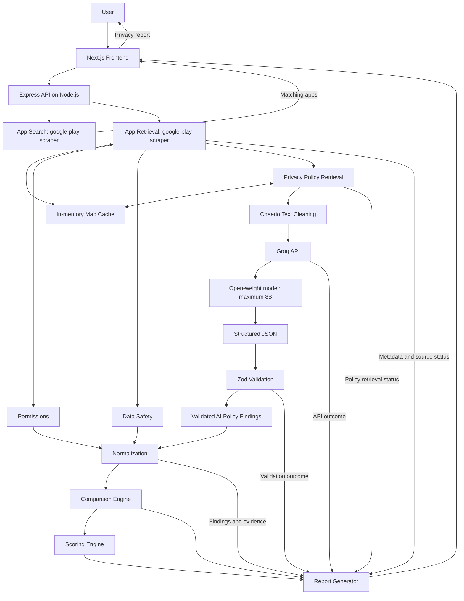
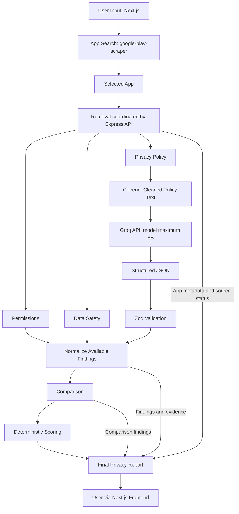

# PrivacyLens Architecture

This document describes the agreed MVP system architecture and data flow. It is a design for implementation, not a claim that the application already exists. The repository currently contains documentation only. The stack is finalized below; exact API schemas and remaining implementation details are **TO BE FINALIZED**.

## 1. Architecture Goals

- Keep development practical for a three-person, 2.5-hour hackathon.
- Separate responsibilities and integrate through agreed contracts.
- Tolerate retrieval failures and expose incomplete information.
- Use structured AI output with deterministic comparison and scoring.
- Keep the frontend independent of internal processing details.

## 2. High-Level Components

These are logical responsibilities, not separate deployed services. The Express API coordinates search and analysis; deployment and module layout are **TO BE FINALIZED**.

### Frontend

Uses **Next.js + TypeScript + Tailwind CSS** for UI responsibilities only: app search input, multiple search results, loading/progress states, the privacy report, and error/partial-data states.

### API / Backend

Uses **Node.js + Express + TypeScript** to expose search and analysis endpoints, coordinate retrieval and privacy analysis, and return the agreed report structure. Retrieval, Groq calls, and privacy processing belong behind this API.

### Application Search

Uses `google-play-scraper` to receive an app name, search Google Play, and return multiple matching apps for user selection.

### App Data Retrieval

Uses `google-play-scraper` to retrieve selected-app metadata, permissions where available, Data Safety declarations where available, and the privacy-policy URL where available. Records availability separately for each source.

### Privacy Policy Retrieval

Downloads privacy-policy HTML, then uses **Cheerio** to remove irrelevant HTML and extract readable text. Returns cleaned policy text with its source reference. The HTTP download mechanism remains **TO BE FINALIZED**; Cheerio handles HTML parsing and cleaning.

### AI Policy Analyzer

Uses **Groq API** with an open-source/open-weight model of **8B parameters or smaller** to analyze cleaned policy text and return structured JSON findings with supporting evidence and `found`, `not_found`, or `unclear` classifications. The exact model is **TO BE CONFIRMED** on the hackathon account. Validate JSON with **Zod** before normalization. It **does not generate the final score**.

### Normalization Layer

Maps different source terminology into shared privacy categories. For example, `ACCESS_FINE_LOCATION`, “Precise location,” and “Geolocation information” map to `location`. Preserve source, evidence, and meaning: a permission remains a capability, not proof of collection. Category mappings are **TO BE FINALIZED**.

### Comparison Engine

Deterministically compares normalized permissions, Data Safety, and policy findings. Possible outcomes are consistent, possible mismatch, unclear, or insufficient information. Missing data alone is not a mismatch.

### Scoring Engine

Applies deterministic rules to calculate a 0–100 score and risk level. **100 = better privacy / lower privacy risk; 0 = worse privacy / higher privacy risk.** Exact weights and thresholds belong in `docs/SCORING.md` and are **TO BE FINALIZED**.

### Report Generator

Combines app metadata, source status, normalized findings, evidence, comparisons, and scoring into the frozen fields: `app`, `score`, `riskLevel`, `sourceStatus`, `permissions`, `dataCollected`, `dataShared`, `mismatches`, `positiveFindings`, `summary`, and `evidence`.

### Cache

Uses an **in-memory `Map`** to avoid repeated Play Store and policy requests and improve demo reliability using previously retrieved real data. **Cached data must never be fabricated.** Distinguish cached information from fresh retrieval where relevant. The cache is lost on process restart; expiration and fallback policy are **TO BE FINALIZED**. No database is required or planned for the MVP; introducing one requires an explicit team decision.

## 3. System Architecture Diagram



## 4. Main Data Flow

1. User enters an app name.
2. Frontend sends a search request.
3. Application Search returns matching apps.
4. User selects one app.
5. Backend retrieves its metadata.
6. Backend retrieves permissions.
7. Backend retrieves Data Safety declarations.
8. Backend retrieves the privacy-policy URL.
9. Policy HTML is downloaded and cleaned using Cheerio.
10. Clean text is sent through Groq API to the eligible model (exact model **TO BE CONFIRMED**).
11. AI returns structured JSON findings and evidence; Zod validates output before use.
12. Source terminology is normalized without losing provenance.
13. Comparison engine compares available sources.
14. Scoring engine applies the agreed deterministic rules.
15. Report generator creates the final report, including `sourceStatus`.
16. Frontend displays findings, evidence, and incomplete-data notices.

Unavailable sources do not stop the whole report where useful partial results remain. Incomplete-input scoring behavior is **TO BE FINALIZED**; never imply that missing data means low risk.

## 5. Data Flow Diagram



## 6. Analysis Sequence

```mermaid
sequenceDiagram
    actor U as User
    participant F as Next.js Frontend
    participant B as Express API
    participant P as google-play-scraper
    participant R as Policy Retriever / Cheerio
    participant A as Groq API / Model maximum 8B
    participant C as Comparison Engine
    participant S as Scoring Engine
    U->>F: Search app name
    F->>B: Request search
    B->>P: Search Google Play
    P-->>B: Matching apps
    B-->>F: Search results
    F-->>U: Show matching apps
    U->>F: Select app
    F->>B: Request analysis
    B->>P: Retrieve metadata and source data
    P-->>B: Metadata, permissions, Data Safety, policy URL, statuses
    opt Data Safety unavailable or failed
        B->>B: Record source status and continue with available data
    end
    alt Policy URL available
        B->>R: Fetch and clean policy
        R-->>B: Cleaned text or retrieval failure
    else Policy URL unavailable
        B->>B: Record policy unavailable
    end
    alt Usable policy text available
        B->>A: Extract structured privacy information
        A-->>B: Structured JSON and evidence, or analysis failure
        B->>B: Validate JSON with Zod
        opt Invalid output and controlled retry practical
            B->>A: Retry extraction within agreed limit
            A-->>B: Structured JSON or failure
            B->>B: Validate retry with Zod
        end
        B->>B: Exclude invalid findings; continue partially on failure
    else Policy retrieval unavailable or failed
        B->>B: Skip AI extraction and preserve partial results
    end
    B->>B: Normalize available findings
    B->>C: Normalized sources with availability
    C-->>B: Comparisons and uncertainty
    B->>S: Available findings and comparisons
    S-->>B: Score and risk under agreed incomplete-input rules
    B->>B: Build report with evidence and sourceStatus
    B-->>F: Full or partial privacy report
    F-->>U: Display report and limitations
```

## 7. Module Boundaries

| Owner | Responsibility | Branch |
| --- | --- | --- |
| Member 1 — Frontend / UX | Search, results, loading, report, components, styles. | `feat/frontend` |
| Member 2 — App Data / Retrieval | Search, metadata, source retrieval, policy cleaning, retrieval cache. | `feat/app-data` |
| Member 3 — Privacy Engine / Integration | AI extraction, normalization, comparison, scoring, report generation, integration. | `feat/privacy-engine` |

Modules communicate through agreed contracts; teammates must discuss changes before editing one another's internals. Follow [SOURCE_OF_TRUTH.md](SOURCE_OF_TRUTH.md). Exact interfaces belong in `docs/API_CONTRACT.md` (**TO BE FINALIZED**; file not yet created).

## 8. Core Data Contracts

- **Search → frontend:** `appId`, `name`, `developer`, `icon`, `rating`, `category` for each match.
- **Retrieval → privacy engine:** normalized source data in a consistent structure, source availability, policy text, and provenance. Semantic privacy-category normalization remains the privacy engine's responsibility.
- **Privacy engine → frontend:** the frozen report fields listed in Section 2, with `sourceStatus` exposing individual source availability.

Exact request/response schemas belong in `docs/API_CONTRACT.md`. Nested shapes, error formats, and missing-value representations are **TO BE FINALIZED**; this document does not define a competing contract.

## 9. Failure Handling

Partial source failure should produce a partial report instead of crashing the full flow where possible.

| Condition | Expected behavior |
| --- | --- |
| App search fails | Show a clear search error and allow retry; do not fabricate results. |
| Permissions unavailable | Record source status; continue with other sources without treating missing permissions as an empty verified list. |
| Data Safety unavailable | Record source status; continue without inferring no collection or sharing. |
| Privacy policy unavailable | Record missing source; skip policy AI analysis and retain other findings. |
| Policy fetch fails | Record failure; use eligible real cached data if available, otherwise continue partially. |
| AI unavailable | Retain retrieved sources, omit AI-derived findings, and show that policy analysis could not complete. |
| AI structured output invalid | Reject output failing JSON parsing or Zod validation; attempt a controlled retry where practical, otherwise continue partially and show analysis failure without crashing the report. Retry limits are **TO BE FINALIZED**. |
| Cached result available | Use it under the agreed fallback policy; disclose cached status and relevant age. |

Use `sourceStatus` for permissions, Data Safety, and privacy policy. Conceptual statuses are `available`, `unavailable`, `failed`, and `cached`; their exact schema and semantics are **TO BE FINALIZED** in `docs/API_CONTRACT.md`. Retrieval success must not imply AI analysis success. How analysis errors and freshness are represented is also **TO BE FINALIZED**, without adding or renaming frozen top-level fields independently.

Missing information is neither evidence of good privacy behavior nor an automatic mismatch. If insufficient evidence prevents a meaningful score, its representation must follow the agreed incomplete-input contract rather than inventing a reassuring score.

## 10. AI Boundary

**Input:** cleaned privacy-policy text. **Output:** structured JSON privacy information and supporting evidence, validated with Zod before use.

AI performs extraction, classification, evidence selection, and simple explanations. It must not invent missing facts, treat absence as proof, calculate the final privacy score, or claim runtime behavior has been observed. `not_found` means absent from the inspected text, not proof that a practice does not occur.

**Provider: Groq API. Model: TO BE CONFIRMED. Maximum size: 8B parameters.** The model must be **open-source/open-weight**, used meaningfully for core policy analysis, not only cosmetic summaries. Confirm availability on the hackathon account before documenting the exact model name, model ID, and parameter count. Those details, prompt version, and exact Zod validation schema belong in `docs/AI_SPEC.md` (file not yet created); prompt and schema remain **TO BE FINALIZED**.

## 11. Scoring Boundary

AI findings + permissions + Data Safety findings, normalized and compared with source availability, feed **deterministic scoring rules**. AI never assigns the score.

The score spans **0–100**: **100 = lower privacy risk; 0 = higher privacy risk**. Risk labels are **LOW**, **MODERATE**, **HIGH**, and **VERY HIGH**. Exact weights, thresholds, and incomplete-input rules belong in `docs/SCORING.md` (**TO BE FINALIZED**; file not yet created).

## 12. Architecture Limitations

- No runtime app behavior observation, APK reverse engineering, or network traffic inspection.
- Data Safety is developer-provided; permissions describe access capabilities, not proven collection.
- Privacy policies may be ambiguous, external scraping can fail, and AI may misinterpret text.
- Cached information may be older than current disclosures; findings are not legal advice or accusations of misconduct.

## 13. Future Architecture

Possible extensions include APK static analysis, tracker/SDK detection, runtime network analysis, privacy-friendly app recommendations, and real-time privacy monitoring. **None are part of the current MVP.**

## Configuration and Tooling

Use **npm** for package management, **Git + GitHub** for version control, and **Markdown + Mermaid** for documentation diagrams.

The backend expects the environment variable `GROQ_API_KEY`. Secrets belong in local `.env` configuration and must never be committed or exposed to the frontend. `.env.example` must contain variable names only, without values. These configuration files have not yet been created.
