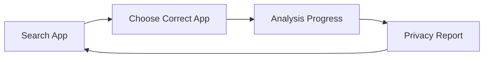

# PrivacyLens Design

This document defines the MVP user experience, screens, report layout, terminology, risk presentation, and UI behavior for the frontend teammate. PrivacyLens helps consumers understand Android app privacy without security or legal expertise.

**Know what an app knows about you before you install it.**

## 1. Design Goals

Keep the interface simple, modern, trustworthy, privacy-focused, consumer-friendly, fast to understand, and practical for a hackathon demo. Users should understand the main result within a few seconds.

Avoid terminal/hacker styling, excessive jargon, fearmongering, clutter, unnecessary animation, and using red for everything. Exact typography, spacing, and visual tokens are **TO BE FINALIZED**.

## 2. Primary User Flow

1. User opens PrivacyLens.
2. Searches for an Android app.
3. Sees multiple matching apps.
4. Selects the correct app.
5. Starts privacy analysis.
6. Sees meaningful progress.
7. Available sources are analyzed.
8. Reads the privacy report.
9. Can search for another app.

## 3. Landing Page

- **Heading:** “Know Before You Install”
- **Supporting message:** “Search an Android app and understand what it can access, what data it says it collects, and whether its privacy disclosures agree.”
- **Main component:** a large, visibly labeled search field.
- **Placeholder:** “Search an Android app...”
- **Primary action:** “Search”.

Keep this screen minimal and the search action prominent.

## 4. Search Results

Each result shows its icon, app name, developer, rating, and category where available, with an **“Analyze”** action. Keep developer identity visible to distinguish similarly named apps. Missing optional metadata must not be fabricated.

The user must choose the app. Never automatically select the first result.

## 5. Analysis / Loading Screen

Analysis involves several backend steps. Show a labeled checklist, not only a spinner: Searching app information → Retrieving permissions → Retrieving Data Safety → Retrieving privacy policy → AI analyzing policy → Comparing disclosures → Calculating score → Generating report.

Keep progress labels consumer-friendly; do not expose implementation jargon such as Zod, Cheerio, or Express in the UI.

| State | Presentation |
| --- | --- |
| Complete | Check icon plus completed-step text. |
| Active | Activity indicator plus current-step text. |
| Pending | Neutral marker plus pending-step text. |
| Unavailable / Failed | Distinct icon and explicit status; explain continuation. |

Continue with available sources when one fails. Never mark failed steps complete or invent progress from timers. Progress reporting mechanics are **TO BE FINALIZED** with the API contract; until supported, show truthful general activity rather than fabricated step completion.

## 6. Report Header

Show app icon, app name, developer, privacy score, and risk level. Display the score as **0–100**, with a visible explanation: **100 = better privacy / lower risk; 0 = worse privacy / higher risk**.

Use **LOW**, **MODERATE**, **HIGH**, or **VERY HIGH**. Exact thresholds belong in `docs/SCORING.md`; the frontend must not calculate independent thresholds or generate its own score.

Report order: header → source status → quick summary → permissions → data collection → data sharing → prominent mismatches/uncertainty → positive findings → “Why Should I Care?” → evidence. Evidence can also expand beside its associated finding. Keep “Search another app” readily available.

## 7. Source Status

Show **Permissions**, **Data Safety**, and **Privacy Policy** directly below the header, using `sourceStatus`.

| Display label | Meaning to communicate |
| --- | --- |
| Available | Source information was retrieved. |
| Unavailable | Source information was not available. |
| Failed | Retrieval could not be completed. |
| Cached | Previously retrieved real information is being used; show relevant age when supplied. |

These are conceptual labels; exact API status values and freshness fields are **TO BE FINALIZED**. Missing information must not resemble a positive result. Policy retrieval success does not imply successful AI analysis: show analysis failure separately using the agreed contract. Cached results must never be fabricated.

## 8. Quick Summary

Show approximately 3–5 short, evidence-supported findings from `summary`; do not pad sparse results with invented statements. Example wording, only when supported:

- “The app requests precise location access.”
- “Location collection is disclosed.”
- “Some information may be shared with advertising partners.”
- “Data deletion appears available.”
- “One possible disclosure mismatch was found.”

## 9. Permissions Section

**Heading: “What Can This App Access?”**

Translate technical names: `ACCESS_FINE_LOCATION` → Precise Location; `READ_CONTACTS` → Contacts; `RECORD_AUDIO` → Microphone.

Possible categories: Location, Camera, Microphone, Contacts, Photos, Files, SMS, Phone, Calendar, and Nearby Devices. Each item shows its readable name and a short explanation. Risk and expected/unusual indicators are optional and require agreed, supported classifications; their rules are **TO BE FINALIZED**.

State that requested access does not prove collection or that permission was granted. Render findings from `permissions` without inferring runtime behavior.

## 10. Data Collection Section

**Heading: “What Data Does It Collect?”**

Clarify beneath the heading: “Based on developer disclosures and privacy-policy findings; actual collection has not been observed.” Render `dataCollected` with data type, purpose, source, and supported risk indicator where available.

Possible categories: Personal Information, Location, Financial Information, Contacts, Messages, Photos and Videos, Audio, App Activity, and Device Identifiers. Do not display a category as collected merely because a related permission exists.

## 11. Data Sharing Section

**Heading: “Who Gets Your Data?”**

Render `dataShared` with attribution to the available disclosures. Explain recipients plainly: service providers help operate the service; analytics providers help measure usage; advertising partners support advertising; affiliates are related companies; business partners are partners named or described in the disclosure.

Show only supported recipients and purposes. Do not infer sharing from a permission or an absent disclosure.

## 12. Privacy Mismatches

Make this report section visually prominent, with concise titles and expandable evidence. Use **POSSIBLE MISMATCH**, **UNCLEAR DISCLOSURE**, **POSSIBLE DISCLOSURE INCONSISTENCY**, or **INSUFFICIENT INFORMATION**, matching the supported finding.

Example when all relevant sources were successfully inspected:

> **UNCLEAR DISCLOSURE — Contacts not clearly disclosed**
>
> Permission: Contacts access requested.
>
> Data Safety: No clear declaration found.
>
> Privacy Policy: No clear contact-data explanation found.
>
> Explanation: The available privacy disclosures do not clearly explain this permission.
>
> Evidence: Expand to inspect the sources.

Missing sources instead require **INSUFFICIENT INFORMATION**, not an automatic mismatch. Do not imply all uncertainty labels are confirmed entries in `mismatches`; exact representation belongs in the API contract. Never say “The company is lying” or “The app steals your data.”

## 13. Positive Findings

Show `positiveFindings` separately so the report is balanced. Supported examples include encryption mentioned, data deletion available, clear disclosure, and a clear retention period. Preserve attribution: a policy mentioning encryption is not independent verification.

“No major inconsistencies found” must be qualified by the sources successfully compared. Never use it as reassurance when the comparison could not run or coverage was insufficient.

## 14. Why Should I Care?

Explain practical meaning in neutral language alongside the relevant findings or in a short report section:

- **Location:** “This app may request access to where you are. Location may be used for functionality, personalization, analytics, or advertising depending on the developer's disclosed practices.”
- **Contacts:** “If you grant this permission, the app may be able to access information stored in your address book.”

These explanations are presentation content, not an additional frozen report field. Do not imply that every listed use occurs in the selected app.

## 15. Evidence

Use expandable evidence panels linked to findings. Evidence may come from Permissions, Data Safety, or Privacy Policy. For policy evidence, show the finding, source reference, short excerpt, and status/confidence where supplied. Do not invent confidence percentages.

Keep large policy paragraphs collapsed. Explain `found`, `not_found`, and `unclear` in plain language; `not_found` means not found in the inspected text, not proof that a practice is absent. Preserve evidence attribution and relevant cached-data context.

## 16. Missing Data

Use explicit messages:

- “Privacy policy could not be retrieved.”
- “Data Safety information is unavailable.”
- “Permission information could not be loaded.”
- “Not enough information is available to compare this category.”

Do not turn unknown values into empty verified lists, zero findings, safe badges, or a fabricated score. Score/risk representation for insufficient evidence is **TO BE FINALIZED** in the API and scoring contracts; show an honest explanatory state when no meaningful score is supplied.

## 17. Error States

| State | Message and action |
| --- | --- |
| No search results | “No matching apps found.” Allow changing the query and searching again. |
| Search failure | “App search could not be completed.” Offer “Retry”. |
| Analysis failure | “Analysis could not be completed.” Offer “Retry” and “Search another app”. |
| Partial report | “Some sources could not be checked.” Keep available findings visible with source status; offer “Retry”. |
| AI analysis failure | “Privacy-policy analysis could not be completed.” Keep other source findings, clearly mark the limitation, and offer “Retry”. |

Retry behavior and request mechanics are **TO BE FINALIZED** in `docs/API_CONTRACT.md`. Do not imply a successful retry before receiving a result.

## 18. Visual Risk Language

Use **LOW**, **MODERATE**, **HIGH**, and **VERY HIGH** consistently. Combine readable text, a badge, an icon, and optional color; never rely on color alone. Keep source availability distinct from privacy risk.

Exact colors are **TO BE FINALIZED**. Score thresholds are **TO BE FINALIZED** in `docs/SCORING.md`, not in this document.

## 19. Components

Suggested components: `SearchBar`, `AppCard`, `AnalysisProgress`, `PrivacyScore`, `SourceStatus`, `QuickSummary`, `PermissionCard`, `DataCollectionCard`, `DataSharingCard`, `MismatchCard`, `PositiveFindingCard`, `EvidencePanel`, and `ErrorState`.

These names are suggestions, not mandatory component architecture.

## 20. Responsive Design

Desktop is the primary demo target; also support tablet and mobile. On smaller screens, stack cards vertically, avoid horizontal scrolling, keep search prominent, and keep the score readable. Allow long app names, excerpts, and source references to wrap. Exact breakpoints are **TO BE FINALIZED**.

## 21. Accessibility

- Combine text and icons with color; maintain readable contrast and font sizes.
- Use clear button text, logical headings, and visible form labels rather than placeholder-only labels.
- Support keyboard search, result selection, retry, and evidence expansion with visible focus.
- Make evidence controls expose their expanded state and announce meaningful loading/error updates accessibly.
- Avoid unnecessary motion and respect reduced-motion preferences.

## 22. Content Rules

Use neutral terminology from [SOURCE_OF_TRUTH.md](SOURCE_OF_TRUTH.md):

| Prefer | Avoid |
| --- | --- |
| “Possible mismatch” | “Privacy violation” |
| “Not clearly disclosed” | “Hidden from users” |
| “The app requests access” when only permissions are known | “The app collects” based only on a permission |

Distinguish requested capabilities, developer declarations, and AI policy findings. Include a brief report limitation that AI can make mistakes and the report is not legal advice.

## 23. MVP UI Priority

1. Search page
2. Search results
3. Loading state
4. Report header
5. Privacy score
6. Quick summary
7. Permissions
8. Data collected
9. Data shared
10. Mismatches
11. Positive findings
12. Evidence
13. Final polish

Integrate source status, partial-data behavior, and errors as each screen is built. Do not prioritize animations before the complete flow works.

## 24. Out of Scope

Do not design authentication, payments, user accounts, APK uploading, malware scanning, network monitoring, GDPR compliance dashboards, iOS support, or enterprise administration.

## Frontend Implementation Context

The agreed frontend uses **Next.js, TypeScript, and Tailwind CSS**. Design UI elements as reusable Next.js/React components; the suggested components in Section 19 remain applicable without prescribing additional architecture.

Use Tailwind consistently instead of mixing styling systems. Do not introduce an additional UI framework unless agreed by the team. Keep the UI lightweight for the 2.5-hour MVP.

## Consistency Rules

Follow [SOURCE_OF_TRUTH.md](SOURCE_OF_TRUTH.md), [ARCHITECTURE.md](ARCHITECTURE.md), `docs/API_CONTRACT.md`, and `docs/SCORING.md`. The latter two files do not yet exist; their details are **TO BE FINALIZED**.

Do not rename frozen report fields, change score direction, or introduce core screens without team agreement. Record major UX decisions changing the frozen flow in `docs/DECISIONS.md` once created. This document defines presentation behavior, not new API fields, scoring rules, or application features.
